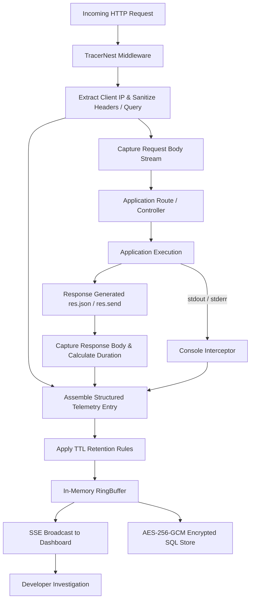

<div align="center">

# TracerNest

### Stop guessing what's happening inside your backend. See it with TracerNest.

**Self-hosted observability and operations dashboard for Node.js applications.**

*Centralized visibility into application logs, HTTP requests and responses, application health, operational diagnostics, and critical events through a configurable dashboard integrated directly into your existing backend.*

---

[](https://www.npmjs.com/package/tracernest-logger)
[](https://www.npmjs.com/package/tracernest-logger)
[](LICENSE)
[](package.json)
[](package.json)
[](https://github.com/ankit-kumar-khandelwal/tracernest-logger/stargazers)
[](https://github.com/ankit-kumar-khandelwal/tracernest-logger/network/members)

[**npm Package**](https://www.npmjs.com/package/tracernest-logger) &bull; [**GitHub Repository**](https://github.com/ankit-kumar-khandelwal/tracernest-logger) &bull; [**Documentation**](docs/introduction.md) &bull; [**Report an Issue**](https://github.com/ankit-kumar-khandelwal/tracernest-logger/issues)

</div>

---

## Table of Contents

- [The Problem We Solve](#the-problem-we-solve)
- [Why TracerNest?](#why-tracernest)
- [Dashboard & Telemetry Console](#dashboard--telemetry-console)
- [Core Features](#core-features)
  - [1. Application Logging](#1-application-logging)
  - [2. API Request and Response Observability](#2-api-request-and-response-observability)
  - [3. Application Health & System Diagnostics](#3-application-health--system-diagnostics)
  - [4. Operations & Security](#4-operations--security)
  - [5. Alerts & Integrations](#5-alerts--integrations)
- [The Complete Request Lifecycle](#the-complete-request-lifecycle)
- [Debug Production Issues Without Guesswork](#debug-production-issues-without-guesswork)
- [Quick Start](#quick-start)
  - [1. Installation](#1-installation)
  - [2. Express Setup](#2-express-setup)
  - [3. Fastify Setup](#3-fastify-setup)
  - [4. Native Node.js HTTP Server Setup](#4-native-nodejs-http-server-setup)
  - [5. Standalone Port Setup (Optional)](#5-standalone-port-setup-optional)
- [Configuration Reference](#configuration-reference)
- [Security & Privacy](#security--privacy)
  - [Production Security Checklist](#production-security-checklist)
- [Documentation Architecture](#documentation-architecture)
- [Contributing & Community](#contributing--community)
- [License](#license)

---

## The Problem We Solve

Every backend engineer has experienced the most frustrating kind of production incident:

1. **It worked in development.** Unit tests passed cleanly.
2. **It passed QA testing.** Staging environments showed zero regressions.
3. **It ran in production for thousands of requests without incident.**
4. **An unpredicted edge-case request arrives and the API fails with an unexpected error.**

When developers open their terminal or log aggregator to investigate, they encounter the **missing context trap**:

```text
[2026-11-18 10:14:02] ERROR: Cannot read properties of undefined (reading 'taxRate')
    at calculateTaxes (/app/dist/services/tax.js:42:18)
    at checkout (/app/dist/controllers/checkout.js:89:12)
```

The error stack trace tells you *where* the code broke, but fails to answer the critical questions required to reproduce and fix it:
- What exact HTTP method and URL endpoint was called?
- What query parameters were passed?
- What was the client's payload (request body)?
- Which client IP or user initiated the request?
- What response payload and status code were returned?
- How long did the request run before failing?
- What application logs (`stdout`, `stderr`, debug traces) were emitted during that specific execution window?

Without this execution context, reproducing the bug locally is pure speculation. Developers spend hours writing defensive code blindly or adding temporary log lines and waiting for the failure to strike again.

**TracerNest eliminates this guesswork.** It acts as an embedded telemetry flight recorder for your Node.js backend, capturing incoming request parameters, outgoing response payloads, application logs, and system health in one self-hosted dashboard.

---

## Why TracerNest?

TracerNest was built out of real production engineering experience to overcome two distinct operational limitations:

### 1. No Mandatory Monitoring Port Overhead
Existing self-hosted Node.js tools (such as Errsole) often require a separate monitoring port. In containerized environments, Kubernetes clusters, serverless containers, or locked-down enterprise VPCs, exposing a secondary port introduces real friction:
- Additional load-balancer target groups, ingress rules, and security group rules.
- Increased public network exposure and firewall change requests.
- Port-binding conflicts in single-port container platforms.

**TracerNest is designed around path-based integration.** The dashboard and telemetry APIs mount directly onto your existing HTTP application (e.g., `app.use(tracer.middleware())`). You access the complete console at `https://api.yourdomain.com/tracernest` with **zero extra ports required** for supported path-based access. *(For setups that prefer network isolation, an optional standalone listener `tracer.listen(8001)` is also provided.)*

### 2. Embedded Zero-Dependency Reliability
Many observability libraries drag dozens of external dependencies into your runtime bundle, introducing supply-chain risks, vulnerability alerts, and version conflicts. TracerNest maintains strictly **zero runtime dependencies** (`dependencies: {}`). It relies exclusively on native Node.js standard libraries (`node:crypto`, `node:http`, `node:sqlite`, `node:net`, `node:tls`).

### Architectural Comparison

| Architectural Characteristic | Traditional SaaS APM | Dedicated-Port Tools | TracerNest |
| :--- | :--- | :--- | :--- |
| **Hosting Model** | Third-party cloud vendor | Self-hosted | **Self-hosted** |
| **Network Integration** | External agent daemon | Requires dedicated port | **Path-based on existing app (or dedicated port)** |
| **Runtime Dependencies** | Heavy vendor SDKs | Multiple npm packages | **Zero runtime dependencies (`0`)** |
| **Data Privacy & Control** | Data leaves infrastructure | Local SQLite / MySQL | **Encrypted local SQLite (`node:sqlite`) or MySQL** |
| **Payload Observability** | Sampled / complex setup | Supported | **Automatic with circular & sensitive data masking** |
| **Cost Predictability** | Volume-based SaaS billing | Free / Self-hosted | **Open-source (Apache 2.0)** |

*Note: TracerNest is designed for in-process application observability, log inspection, and rapid production debugging. It complements rather than replaces fleet-wide distributed tracing platforms (such as OpenTelemetry).*

---

## Dashboard & Telemetry Console

TracerNest features a refined, dark-mode operations console engineered for clarity under incident pressure.

```
+----------------------------------------------------------------------------------------------------+
|  TRACERNEST  |  Live Logs  |  API Requests  |  Health: OK  |  Settings         [Admin (Operator)]  |
+----------------------------------------------------------------------------------------------------+
|  Search logs, endpoints, or regex...                      [ALL] [ERROR] [WARN] [INFO] [HTTP]       |
+----------------------------------------------------------------------------------------------------+
|  10:14:02.891  HTTP  POST /api/checkout            500  (84ms)   198.51.100.42                     |
|  10:14:02.890  STDERR Error: Cannot read properties of undefined (reading 'taxRate')               |
|  10:14:02.840  STDOUT [Orders] Calculating tax rate for cart_99120                                 |
|  10:13:58.120  HTTP  GET  /api/products?cat=tools  200  (12ms)   203.0.113.195                     |
+----------------------------------------------------------------------------------------------------+
```

### Visual Preview & Assets

The dashboard user interface is accessible directly from your repository assets:

<div align="center">


*TracerNest embedded operations dashboard preview located at [assets/screenshots/dashboard-preview.jpge](assets/screenshots/dashboard-preview.jpeg).*

</div>

---

## Core Features

Verified capabilities implemented in the codebase:

### 1. Application Logging
- **Console Output Interception:** Transparently intercepts `stdout` and `stderr` without disrupting standard terminal output or container logging pipelines.
- **Structured Framework Support:** Automatically parses JSON structures and maps severity levels from Winston, Pino (numeric levels 10–60), and Bunyan.
- **Real-Time Log Streaming:** Streams live log events to the browser dashboard via Server-Sent Events (SSE) with sub-millisecond latency.
- **In-Memory Ring Buffer:** Retains recent logs in a memory-bounded circular buffer (`RingBuffer`) with configurable capacity (default: 5,000 entries).
- **Multi-Field Filtering:** Search and filter by severity level (`error`, `warn`, `info`, `debug`), text substring, or regular expressions.

### 2. API Request and Response Observability
- **HTTP Interception:** Intercepts incoming requests and outgoing responses across Express, Fastify, and native Node.js HTTP servers.
- **Payload Inspection:** Captures sanitized request bodies and response payloads (up to 512 KB default) for post-mortem analysis.
- **Latency Tracking:** Measures request execution duration in milliseconds (`durationMs`).
- **Safe Body Sanitization:** Recursively sanitizes JSON objects with circular reference protection (`WeakSet`) and depth limits, preventing call stack overflow crashes on ORM instances (Sequelize, Mongoose, TypeORM).
- **Query Parameter Redaction (SEC-07):** Automatically masks sensitive query strings (`token`, `secret`, `password`, `key`, `auth`) in captured URLs.
- **Route Exclusions:** Exclude high-frequency health endpoints or sensitive routes via globs (`/api/auth/*`), RegExps, predicates, or dynamically via the UI dashboard.

### 3. Application Health & System Diagnostics
- **Dual-Tier Health Endpoint (SEC-05):** Minimal public `/api/health` probe for Kubernetes/load-balancer liveness checks; authenticated requests receive full diagnostics.
- **System Memory Metrics:** Real-time visibility into heap used, heap total, RSS, and heap usage percentage.
- **Runtime Metrics:** Uptime duration counter, Node.js runtime version, process ID (PID), OS platform, and CPU architecture.
- **Database & Telemetry Health:** Storage connection state, dialect (`sqlite` / `mysql`), buffer utilization percentage, and throughput per second.

### 4. Operations & Security
- **Zero Runtime Dependencies:** Exactly `dependencies: {}`. Zero supply-chain attack surface and pristine `npm audit` reports.
- **Encrypted SQL Storage:** Encrypted local SQLite storage (`node:sqlite`) with auto-synchronized encrypted SQL file mirroring, or external MySQL.
- **Data Protection:** Built-in AES-256-GCM symmetric encryption for database files and Scrypt password hashing with unique salts.
- **Hardened RBAC:** Three role tiers (`Admin`, `Developer`, `Viewer`) with granular permission controls.
- **Reverse Proxy Hardening (SEC-10):** Direct TCP socket extraction by default, trusted right-to-left X-Forwarded-For traversal, and dual-keyed login throttling (IP + account).
- **Request Body Bounding (SEC-09):** Hard memory bounding on request streams with immediate listener detachment and HTTP 413 responses.
- **CLI Password Recovery:** Emergency root password recovery tool (`npx tracernest-reset-admin`).

### 5. Alerts & Integrations
- **Zero-Dependency SMTP Email:** Pure Node.js TLS/TCP client for dispatching incident reports to team inboxes.
- **Microsoft Teams Incoming Webhooks:** Formats and dispatches incident MessageCards directly to Teams channels.
- **Automated Cooldown Throttling:** Built-in 30-second cooldown per channel prevents notification flooding during cascade failures.
- **Interactive UI Testing:** Operators can trigger live test alerts directly from dashboard settings.

---

## The Complete Request Lifecycle

TracerNest instruments the request-response lifecycle from entry to exit:



### Realistic Execution Boundaries
- **In-Process Telemetry:** TracerNest executes inside the host Node.js application process.
- **Process Exit Boundary:** If the Node.js process terminates abruptly due to a fatal OS signal (`SIGKILL`) or native C++ addon segmentation fault before the response completes, in-flight request logging cannot finish.
- **Exception Capture:** For standard unhandled JavaScript exceptions or rejections, TracerNest's `stderr` interceptor captures the full stack trace before process exit.

---

## Debug Production Issues Without Guesswork

When a production-only bug occurs, TracerNest enables rapid triage:

1. **Locate the Failure:** Filter the live log stream by `[ERROR]` or search for the endpoint path (e.g., `/api/checkout`).
2. **Inspect the Client Context:** Identify the verified client IP, exact timestamp, and duration of the failing call.
3. **Inspect the Request Payload:** View the exact JSON body submitted by the client that triggered the edge case.
4. **Inspect the Response:** Confirm the exact HTTP status code and error payload returned.
5. **Correlate Terminal Logs:** Inspect application console logs emitted during the same execution window to trace internal service calls.
6. **Reproduce Locally:** Copy the sanitized JSON payload into a local unit test, verify the fix, and deploy with confidence.

### Current Correlation Capabilities vs. Future Enhancements

| Capability | Current Status | Description |
| :--- | :--- | :--- |
| **Timestamp Correlation** | **Supported** | Millisecond-precision timestamps across HTTP requests, stdout, and stderr. |
| **Client IP Association** | **Supported** | Group requests and errors originating from the same client peer address. |
| **Payload Inspection** | **Supported** | Full request and response payload capture with recursive sensitive-data redaction. |
| **Log Source Separation** | **Supported** | Clear classification of `http`, `stdout`, `stderr`, and `api` log streams. |
| **Request Correlation IDs** | *Roadmap* | Automatic injection of `X-Request-Id` and `AsyncLocalStorage` context propagation to link console logs directly to parent HTTP requests. |

---

## Quick Start

### 1. Installation

```bash
npm install tracernest-logger
```

### 2. Express Setup

```typescript
import express from 'express';
import { TracerNestLogger } from 'tracernest-logger';

const app = express();
const PORT = process.env.PORT || 3000;

// Body parsers (optional, TracerNest captures bodies with or without them)
app.use(express.json());

// Initialize TracerNest
const tracer = new TracerNestLogger({
  path: '/tracernest',              // Dashboard mount path
  title: 'Production API Monitor',  // Custom UI title
  bufferSize: 5000,                 // Ring buffer capacity
  dataDir: './.tracernest'          // Storage directory
});

// Register TracerNest middleware before application routes
app.use(tracer.middleware());

// Your application routes
app.get('/api/users', (req, res) => {
  console.log('[Users] Fetching user directory');
  res.json([{ id: 1, name: 'Alice' }]);
});

app.post('/api/checkout', (req, res) => {
  console.warn('[Checkout] Processing payment');
  res.status(200).json({ status: 'confirmed' });
});

app.listen(PORT, () => {
  console.log(`Server: http://localhost:${PORT}`);
  console.log(`TracerNest: http://localhost:${PORT}/tracernest`);
});
```

### 3. Fastify Setup

```typescript
import Fastify from 'fastify';
import { TracerNestLogger } from 'tracernest-logger';

const fastify = Fastify();
const tracer = new TracerNestLogger({ path: '/tracernest' });

fastify.addHook('onRequest', async (req, reply) => {
  const handled = await tracer.handleRequest(req.raw, reply.raw);
  if (handled) reply.hijack();
});

fastify.listen({ port: 3000 });
```

### 4. Native Node.js HTTP Server Setup

```typescript
import { createServer } from 'node:http';
import { TracerNestLogger } from 'tracernest-logger';

const tracer = new TracerNestLogger({ path: '/tracernest' });

const server = createServer(async (req, res) => {
  const handled = await tracer.handleRequest(req, res);
  if (handled) return;

  res.writeHead(200, { 'Content-Type': 'application/json' });
  res.end(JSON.stringify({ message: 'Hello World' }));
});

tracer.attach(server);
server.listen(3000);
```

### 5. Standalone Port Setup (Optional)

```typescript
import { TracerNestLogger } from 'tracernest-logger';

const tracer = new TracerNestLogger({ path: '/tracernest' });

// Listen on an isolated internal port
tracer.listen(8001, '127.0.0.1', () => {
  console.log('TracerNest standalone dashboard: http://127.0.0.1:8001/tracernest');
});
```

---

## Configuration Reference

```typescript
const tracer = new TracerNestLogger({
  path: '/tracernest',              // Dashboard mount path (default: '/tracernest')
  title: 'Production Telemetry',    // Dashboard browser tab title
  bufferSize: 5000,                 // Circular in-memory buffer capacity
  dataDir: './.tracernest',         // SQLite database & encryption key folder
  masterKey: process.env.KEY,       // 32+ char AES-256-GCM master encryption key
  dialect: 'sqlite',                // 'sqlite' | 'mysql'
  trustProxy: false,                // Reverse proxy trust (false | true | string[] | CIDR)
  maxHttpBodyBytes: 524288,         // Max request/response body capture (512 KB)
  interceptStdout: true,            // Intercept console.log
  interceptStderr: true,            // Intercept console.error
  interceptHttp: true,              // Intercept HTTP request & response payloads
  sensitiveHeaders: ['x-secret'],   // Custom header names to redact
  sensitiveFieldKeys: ['card_no'],  // Custom JSON keys to redact
  excludeRoutes: ['/healthz'],      // Routes excluded from HTTP logging
  gracefulShutdown: true            // Automatic SIGINT/SIGTERM handling
});
```

*For comprehensive options, visit [docs/configuration.md](docs/configuration.md).*

---

## Security & Privacy

TracerNest is hardened against common web and API attack vectors:
- **Scrypt Password Hashing:** Credentials protected by native `crypto.scrypt` with unique salts.
- **Timing-Safe Verification (SEC-01):** Constant-time hash verification via `crypto.timingSafeEqual`.
- **Token Invalidation (SEC-02):** Immediate token revocation on user role modification.
- **Stream Bounding (SEC-09):** Memory bounds on request streams with immediate listener detachment and HTTP 413 responses.
- **Proxy Header Defense (SEC-10):** Direct TCP socket IP extraction by default and reverse traversal from trusted proxy ends.
- **Dual Login Throttling (SEC-10):** Independent IP-level and account-level rate limiting on login attempts.
- **Content Security Policy (CSP):** Embedded dashboard serves strict CSP headers.

### Production Security Checklist

- [ ] Set a strong `masterKey` passphrase (32+ characters) via environment variable.
- [ ] Configure `trustProxy` to match your reverse proxy CIDR (or leave `false` for direct connections).
- [ ] Restrict access to the dashboard path (`/tracernest`) via VPN or reverse proxy allowlists where appropriate.
- [ ] Review `excludeRoutes` to omit sensitive authentication endpoints (`/api/auth/login`) from payload capture.
- [ ] Terminate TLS / HTTPS at your reverse proxy or load balancer.

---

## Documentation Architecture

Complete architectural guides and deep dives are available in the [`docs/`](docs/) directory:

- [**Introduction & Design Goals**](docs/introduction.md) &mdash; Design philosophy, problem context, and architecture.
- [**Getting Started Guide**](docs/getting-started.md) &mdash; Detailed installation and framework setup.
- [**Configuration Reference**](docs/configuration.md) &mdash; Full options catalog and usage examples.
- [**Application Logging**](docs/application-logging.md) &mdash; Console interception, framework support, and ring buffers.
- [**API Observability**](docs/api-observability.md) &mdash; Request/response interception, circular safety, and exclusions.
- [**Health & Diagnostics**](docs/health-monitoring.md) &mdash; Dual-tier health probes and system metrics.
- [**Security & Privacy**](docs/security.md) &mdash; Threat models, remediations, and production checklists.
- [**Production Deployment**](docs/deployment.md) &mdash; Docker, Kubernetes, Nginx, and multi-instance clusters.
- [**Troubleshooting Guide**](docs/troubleshooting.md) &mdash; Solutions to common operational edge cases.
- [**Architecture Deep Dive**](docs/architecture.md) &mdash; Internal component topology and memory lifecycles.
- [**Production Debugging Playbook**](docs/production-debugging.md) &mdash; Step-by-step incident response playbook.

---

## Contributing & Community

TracerNest is open-source software built for backend engineering teams. We welcome contributions, bug reports, and feedback!

- [**Contributing Guide**](CONTRIBUTING.md) &mdash; Development setup, zero-dependency policy, and PR submission rules.
- [**Code of Conduct**](CODE_OF_CONDUCT.md) &mdash; Contributor Covenant v2.1 standards.
- [**Security Policy**](SECURITY.md) &mdash; Vulnerability reporting and security architecture.
- [**Changelog**](CHANGELOG.md) &mdash; Version release history and migration notes.

---

## License

TracerNest is licensed under the [Apache License, Version 2.0](LICENSE). Free for use in commercial applications, open-source projects, and enterprise infrastructure.
