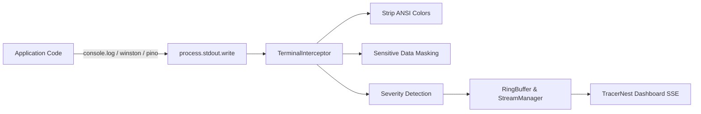

# Application Logging in TracerNest

TracerNest provides zero-latency, in-process application log capture, indexing, and streaming. It captures logs produced by native console methods (`console.log`, `console.error`, `console.warn`, `console.info`) as well as popular Node.js logging libraries (Winston, Pino, Bunyan).

---

## How Log Interception Works

TracerNest hooks directly into Node.js stream writers:
- `process.stdout.write`
- `process.stderr.write`



### Safety Features of Terminal Interception
1. **Zero Disruption to Terminal Streams:** The interceptor transparently passes chunks directly to the original stream writer. Standard container output (Docker logs, Kubernetes logs) is completely preserved.
2. **Infinite Loop Protection:** An internal `isIntercepting` re-entry guard ensures that any console output generated internally by TracerNest never causes an infinite interception loop.
3. **ANSI Color Stripping:** Terminal color formatting codes are automatically stripped from log messages to ensure pristine full-text searching and indexing.
4. **Structured JSON Parsing:** If a log line is emitted as a JSON string (typical of Winston, Pino, or Bunyan), TracerNest parses the payload into structured metadata while detecting severity levels automatically.

---

## Log Severity Level Detection

TracerNest inspects both JSON fields and plain text to categorize log severity:

### 1. Pino Numeric Severity Levels
TracerNest parses Pino numeric log levels according to the standard:
- `10`: `debug` (Trace)
- `20`: `debug` (Debug)
- `30`: `info` (Info)
- `40`: `warn` (Warn)
- `50`: `error` (Error)
- `60`: `error` (Fatal)

### 2. Winston & Bunyan String Severity
String properties like `"level": "warn"` or `"level": "critical"` are automatically mapped into one of four standard TracerNest levels:
- `error`: Fatal, Critical, Error, Exception, or any unhandled stderr output.
- `warn`: Warning, Deprecation.
- `info`: Information, Notice, Success.
- `debug`: Debug, Trace, Verbose.

### 3. Text Prefix Detection
Plain text strings containing tokens like `[ERROR]`, `EXCEPTION:`, `[WARN]` are recognized and categorized appropriately.

---

## Real-Time SSE Log Streaming

The dashboard connects to `/api/logs/stream` using **Server-Sent Events (SSE)**.
- **Instant Push:** Logs appear in the UI the instant they are written to `stdout`/`stderr`.
- **Sub-Millisecond Overhead:** Events are dispatched asynchronously via the in-memory stream manager without blocking the Node.js event loop.
- **Auto-Reconnection:** If the browser connection drops, the UI automatically reconnects with an exponential backoff.

---

## In-Memory Ring Buffer

To maintain zero runtime dependencies and predictable memory consumption, TracerNest uses an in-memory **circular ring buffer** (`RingBuffer`).

```typescript
const tracer = new TracerNestLogger({
  bufferSize: 10000 // Holds the most recent 10,000 logs in RAM
});
```

### Memory Threshold Warning
Each log entry in memory consumes approximately 1 KB to 3 KB depending on payload size.
- **Default Capacity:** 5,000 entries (~10 MB RAM).
- **Recommended Max:** 50,000 to 100,000 entries (~100 MB to 200 MB RAM).
- **Safety Safeguard:** If a developer initializes TracerNest with `bufferSize > 100,000` or heap estimation exceeds 1 GB, TracerNest prints an explicit console warning alerting the team to memory risk.

---

## Programmatic Logging Helper

In addition to intercepting console streams, TracerNest exposes a programmatic logging method:

```typescript
tracer.log('warn', 'Database connection latency spike detected', {
  latencyMs: 420,
  poolSize: 10,
  host: 'db-replica-1'
});
```

Programmatic entries are tagged with source `'api'`, processed by TTL retention rules, and dispatched to configured alert channels (Email / Teams).

