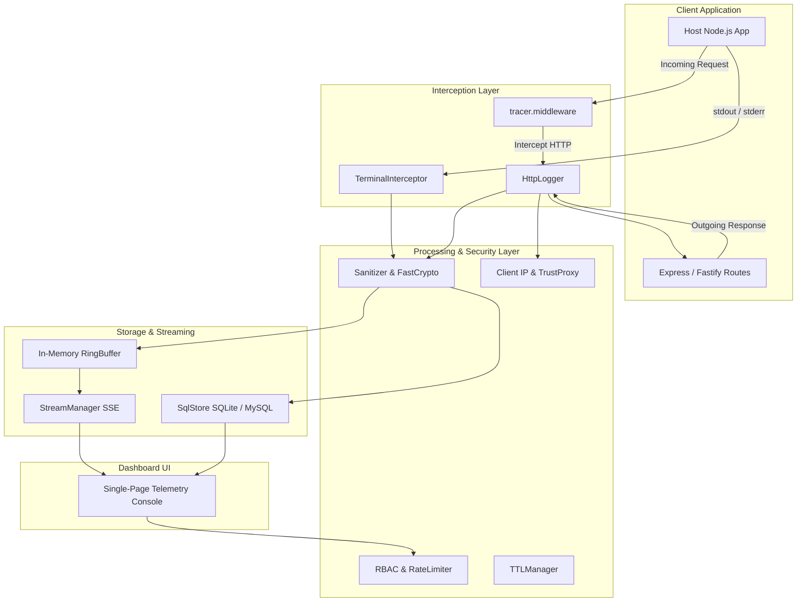

# TracerNest System Architecture

This document describes the internal engineering design, memory lifecycles, and component interactions that power TracerNest.

---

## High-Level Component Topology

---

## Component Breakdown

### 1. `TerminalInterceptor` (`src/core/interceptor.ts`)
- Hooks `process.stdout.write` and `process.stderr.write`.
- Extracts raw stream chunks, strips ANSI formatting, and parses JSON logs (Pino, Winston, Bunyan).
- Categorizes log severity (`error`, `warn`, `info`, `debug`).
- Masks sensitive credentials in both clean and raw representations (SEC-06).

### 2. `HttpLogger` (`src/middleware/http-logger.ts`)
- Manages request and response lifecycle instrumentation.
- Captures query strings, request headers, client IP, request body, response status, duration, and response body.
- Performs recursive object sanitization with circular reference protection (`WeakSet`) and depth limits to prevent stack overflow crashes on ORM instances.
- Evaluates code-based and dynamic UI-managed route exclusion rules.

### 3. `RingBuffer` (`src/core/ring-buffer.ts`)
- A high-performance circular in-memory buffer storing the most recent $N$ telemetry events (default 5,000).
- Provides $O(1)$ insertions and fast paginated range queries.
- Manages memory safety: issues startup warnings if allocation exceeds 100,000 entries.

### 4. `StreamManager` (`src/core/stream-manager.ts`)
- Manages active Server-Sent Events (SSE) connections with connected browser clients.
- Implements broadcast fan-out for live log streaming.
- Periodically emits keep-alive heartbeat comments (`:keepalive\n\n`) to prevent intermediate proxies from closing idle connections.

### 5. `SqlStore` (`src/security/sql-store.ts`)
- Multi-dialect storage abstraction supporting **Node 22 native SQLite** (`node:sqlite`) and **MySQL**.
- Employs AES-256-GCM authenticated encryption for sensitive SQL mirrors and secret storage.
- Automatically handles schema creation and database migrations on initialization.

### 6. `HttpHandler` (`src/middleware/handler.ts`)
- Routes and serves all dashboard requests, REST APIs, static assets, and SSE feeds.
- Enforces Scrypt authentication, HMAC token verification, and RBAC permissions on all API endpoints.
- Implements dual-bucket login rate limiting (IP + username) and request body stream bounding (SEC-09, SEC-10).

### 7. `AlertDispatcher` (`src/alerts/alert-dispatcher.ts`)
- Evaluates intercepted logs against alert threshold policies.
- Features a zero-dependency SMTP client (TLS/TCP) and Microsoft Teams Incoming Webhook poster.
- Enforces an automated 30-second cooldown per channel to prevent alert flooding.

### 8. `GracefulShutdownManager` (`src/core/graceful-shutdown.ts`)
- Intercepts process termination signals (`SIGTERM`, `SIGINT`).
- Closes SSE streams cleanly, drains in-flight requests, flushes SQL storage buffers, and closes the host HTTP listener.

