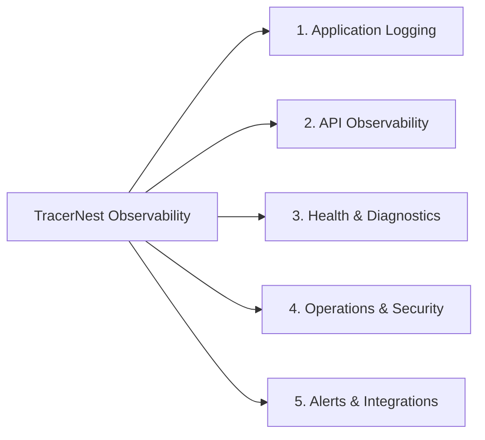

# Introduction to TracerNest

**TracerNest** is an open-source, self-hosted observability and operations dashboard for Node.js applications. It provides centralized visibility into application logs, HTTP requests and responses, application health, operational diagnostics, and critical events through a configurable dashboard integrated directly into your existing backend application.

---

## The Core Problem: Production-Only Bugs & Incomplete Context

Every backend engineering team encounters the dreaded "unrepeatable production incident":

1. **Local Success:** An API endpoint runs cleanly in development and staging environments.
2. **Quality Verification:** Automated integration suites and QA testing pass without error.
3. **Unexpected Production Crash:** Under real-world traffic, an atypical request with an unpredicted payload or edge-case state triggers a 500 Internal Server Error or an unhandled exception.
4. **The Missing Context Trap:** When engineers inspect standard terminal dumps or log collectors, critical pieces of information are missing:
   - What exact HTTP method and URL was invoked?
   - What were the sanitized request headers and query parameters?
   - What JSON payload did the client send?
   - What was the client's verified IP address?
   - What was the exact response status and payload returned?
   - How long did execution take before failing?
   - Which application logs (info, warn, error) were emitted during that specific execution window?

Without this data, reproduction is pure guesswork. Engineers spend hours speculating, writing defensive code blindly, or adding temporary log lines and waiting for the bug to strike again.

**TracerNest solves this problem** by acting as an embedded telemetry flight recorder. It automatically captures incoming request metadata, outgoing response bodies, console output, and system health metrics, presenting them in a unified, searchable, real-time dashboard.

---

## The Infrastructure Problem: Monitoring Port Overhead

When integrating third-party monitoring tools (such as Errsole or dedicated APM agents), developers frequently hit infrastructure friction: **mandatory dedicated monitoring ports**.

In modern cloud environments (Kubernetes, AWS ECS, Heroku, serverless containers, or corporate VPCs), exposing a secondary port introduces real operational complexity:
- Additional ingress rules, load balancer listener bindings, and target groups.
- Network security group modifications and corporate firewall approvals.
- Additional public IP attack surface or internal routing configurations.
- Difficulty running in container environments that mandate a single exposed port.

### TracerNest's Path-Based Integration Architecture

TracerNest was engineered specifically around a **path-based integration approach**:
- **Single Port:** The dashboard and telemetry APIs mount directly onto your existing HTTP server (e.g., `app.use(logger.middleware())`).
- **Configurable Route:** Access the complete telemetry console via a secure path on your application (e.g., `https://api.yourdomain.com/tracernest`).
- **Zero Extra Ports:** No separate monitoring port or external daemon process is required for supported path-based access.
- **Embedded Security:** Secured with Scrypt-hashed credentials, stateless HMAC-SHA256 session tokens, role-based access control (RBAC), and dual-layer rate limiting.
- **Optional Standalone Port:** For architectures that *do* prefer complete network isolation for internal tools, TracerNest also provides an optional standalone listener (`logger.listen(3015)`).

---

## The Five Pillars of TracerNest

TracerNest is built upon five foundational operational pillars:

### 1. Application Logging
- **Console Interception:** Automatically hooks `process.stdout.write` and `process.stderr.write` without disrupting native streaming.
- **Structured Framework Support:** Recognizes JSON structures from Winston, Pino, and Bunyan, automatically parsing severity levels.
- **Live Streaming:** Server-Sent Events (SSE) push log events to the dashboard in real time with sub-millisecond latency.
- **In-Memory Ring Buffer:** Memory-bounded circular buffer prevents out-of-memory crashes while keeping recent logs instantly queryable.
- **Search & Filtering:** Multi-field filtering across severity levels (`error`, `warn`, `info`, `debug`), text queries, and regular expressions.

### 2. API Request and Response Observability
- **HTTP Interception:** Intercepts incoming requests and outgoing responses across Express, Fastify, and native Node.js HTTP servers.
- **Payload Inspection:** Captures sanitized request bodies and response payloads (up to 512 KB) for thorough post-mortem analysis.
- **Execution Timing:** Tracks request duration in milliseconds to pinpoint latency degradation.
- **ORM & Circular Safety:** Protected by recursive circular reference tracking (`WeakSet`) and depth limits, preventing call stack overflow crashes on Sequelize or Mongoose models.
- **Route Exclusions:** Exclude high-frequency health probes or sensitive endpoints via glob patterns, RegExp, custom predicates, or dynamically via the UI dashboard.

### 3. Application Health and System Diagnostics
- **Dual-Tier Liveness Probes:** Provides a lightweight `/api/health` endpoint for Kubernetes/load-balancer liveness checks.
- **Authenticated Diagnostics:** Authenticated operators receive deep diagnostic metrics: process memory (heap used, heap total, RSS, percent usage), uptime, CPU architecture, database status, and log buffer throughput.
- **One-Click Diagnostic Modal:** Embedded dashboard dialog runs live diagnostics without triggering native browser popups.

### 4. Operations and Security
- **Zero Runtime Dependencies:** Strictly zero external npm dependencies (`dependencies: {}`), eliminating supply-chain risk and third-party vulnerabilities.
- **Self-Hosted Data Control:** Telemetry data remains entirely within your infrastructure using encrypted local SQLite (`node:sqlite`) or external MySQL.
- **Data Protection:** Built-in AES-256-GCM symmetric encryption for database files, Scrypt password hashing, and configurable master encryption keys.
- **Hardened RBAC:** Three default privilege tiers (`Admin`, `Developer`, `Viewer`) with granular permission controls.
- **Reverse Proxy Protection (SEC-10):** Direct socket peer extraction by default, with trusted right-to-left X-Forwarded-For traversal and dual-layer rate limiting.
- **Stream Bounding (SEC-09):** Hard memory bounding on request payloads, detaching stream listeners and returning HTTP 413 immediately on threshold violations.

### 5. Alerts and Integrations
- **Zero-Dependency SMTP Email:** Pure Node.js TLS/TCP client for sending incident notifications to team inboxes.
- **Microsoft Teams Webhooks:** Dispatches rich Adaptive Cards / MessageCards to Microsoft Teams channels upon error detection.
- **Automated Cooldown Throttling:** Built-in 30-second cooldown per channel prevents notification flooding during cascade failures.
- **Interactive UI Testing:** Operators can test and verify webhook and SMTP channels directly from the dashboard settings.

---

## When to Choose TracerNest

| Engineering Requirement | SaaS APM (Datadog, New Relic) | Errsole | TracerNest |
| :--- | :--- | :--- | :--- |
| **Hosting Model** | Third-party Cloud | Self-Hosted | **Self-Hosted** |
| **Network Architecture** | Outbound Agent Daemon | Requires Dedicated Port | **Path-Based on Existing App (or Dedicated Port)** |
| **Runtime Dependencies** | Heavy SDK dependencies | Several npm packages | **Zero Runtime Dependencies (`0`)** |
| **Cost Predictability** | Volume-based monthly billing | Free / Self-Hosted | **Free, Open-Source (Apache 2.0)** |
| **Data Residency** | Leaves infrastructure | Local SQLite / MySQL | **Encrypted Local SQLite or MySQL** |
| **API Payload Capture** | Often requires heavy config / sampled | Supported | **Automatic with circular & sensitive data masking** |

