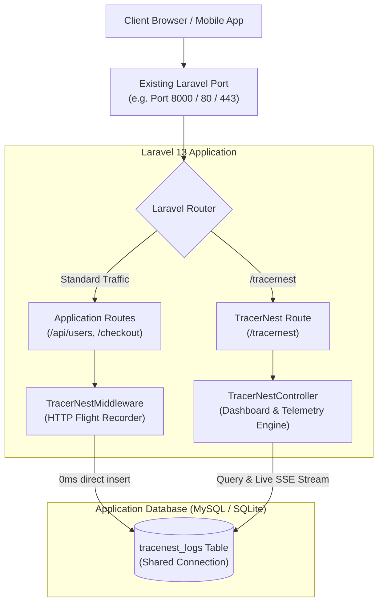

# Laravel 13 Integration Guide (Zero Extra Port Required)

TracerNest provides native, first-class telemetry observability and real-time flight recording for **Laravel 13** (as well as Laravel 12 and 11).

> [!IMPORTANT]
> **NO NEW PORTS OPENED**: You do **NOT** need to open any extra port or run a separate background process. TracerNest mounts directly inside your existing Laravel application on the **exact same port** (e.g. `http://localhost:8000/tracernest` or `https://myapp.com/tracernest`).

---

## Architecture Overview (Zero Port Overhead)



---

## Quick Setup (3 Simple Steps - No Extra Ports)

### Step 1: Install TracerNest in Your Laravel Project

Every Laravel project includes a root `package.json` for Vite. Run in your Laravel root directory:

```bash
npm install tracernest-logger
```

---

### Step 2: Copy the Middleware & Controller into Your Laravel App

Copy the packaged bridge files directly into your Laravel `app/` directory:

```bash
# 1. Copy Middleware
mkdir -p app/Http/Middleware
cp node_modules/tracernest-logger/integrations/laravel/TracerNestMiddleware.php app/Http/Middleware/

# 2. Copy Controller
mkdir -p app/Http/Controllers
cp node_modules/tracernest-logger/integrations/laravel/TracerNestController.php app/Http/Controllers/

# 3. Copy Config (Optional)
cp node_modules/tracernest-logger/integrations/laravel/tracernest.php config/
```

---

### Step 3: Register in Laravel 13

#### A. Register Routes in `routes/web.php`

Add **one line** to your `routes/web.php`:

```php
// routes/web.php
use Illuminate\Support\Facades\Route;

// Mount TracerNest Dashboard on the existing Laravel port
require base_path('node_modules/tracernest-logger/integrations/laravel/routes.php');
```

#### B. Register Middleware in `bootstrap/app.php`

In Laravel 13, global middleware is registered in `bootstrap/app.php`:

```php
// bootstrap/app.php
return Application::configure(basePath: dirname(__DIR__))
    ->withRouting(
        web: __DIR__.'/../routes/web.php',
        api: __DIR__.'/../routes/api.php',
        commands: __DIR__.'/../routes/console.php',
        health: '/up',
    )
    ->withMiddleware(function (Middleware $middleware) {
        // Automatically capture incoming HTTP requests, response payloads & durations
        $middleware->append(\App\Http\Middleware\TracerNestMiddleware::class);
    })
    ->withExceptions(function (Exceptions $exceptions) {
        //
    })->create();
```

---

### Step 4: Open Your Dashboard

Start your Laravel server as you normally do:

```bash
php artisan serve
```
*(Or access your application through Laravel Herd, Docker, FrankenPHP, or Nginx).*

Navigate in your browser to:
**`http://localhost:8000/tracernest`**

🎉 **That's it!**
- **Zero new ports opened.**
- **Zero extra servers or background daemons.**
- Every request hitting your Laravel 13 API is intercepted, sanitized, and visible live in real time on the exact same port!

---

## Laravel Monolog Logging Integration

To also capture all standard Laravel log calls (`Log::info()`, `Log::error()`, `Log::warning()`) and unhandled PHP exception stack traces in TracerNest:

1. Copy the Monolog handler:
   ```bash
   mkdir -p app/Logging
   cp node_modules/tracernest-logger/integrations/laravel/TracerNestMonologHandler.php app/Logging/
   ```

2. In `config/logging.php`, add `tracernest` to your logging channels:
   ```php
   'channels' => [
       'stack' => [
           'driver' => 'stack',
           'channels' => ['single', 'tracernest'],
           'ignore_exceptions' => false,
       ],

       'tracernest' => [
           'driver' => 'custom',
           'via' => \App\Logging\TracerNestMonologHandler::class,
           'level' => env('LOG_LEVEL', 'debug'),
       ],
   ],
   ```

---

## Alternative Option: Standalone Port (Optional)

If your team *specifically prefers* running TracerNest on an isolated internal port (e.g. `8001`), TracerNest also provides the CLI runner:

```json
// package.json
{
  "scripts": {
    "telemetry": "tracernest-server --port 8001"
  }
}
```

```bash
npm run telemetry
```

Both modes use the exact same underlying database and UI features.

---

## Key Benefits for Laravel 13 Teams

1. **No Extra Port Overhead:** Mounts directly on `/tracernest` inside your existing Laravel HTTP pipeline.
2. **Zero Cloud Subscriptions:** 100% self-hosted on your own MySQL or SQLite database.
3. **Hardware AES-256-GCM Encryption:** Sensitive healthcare or financial payloads remain encrypted at rest.
4. **Instant Reproduction:** See the exact incoming request payload and response body for every production 500 error.
